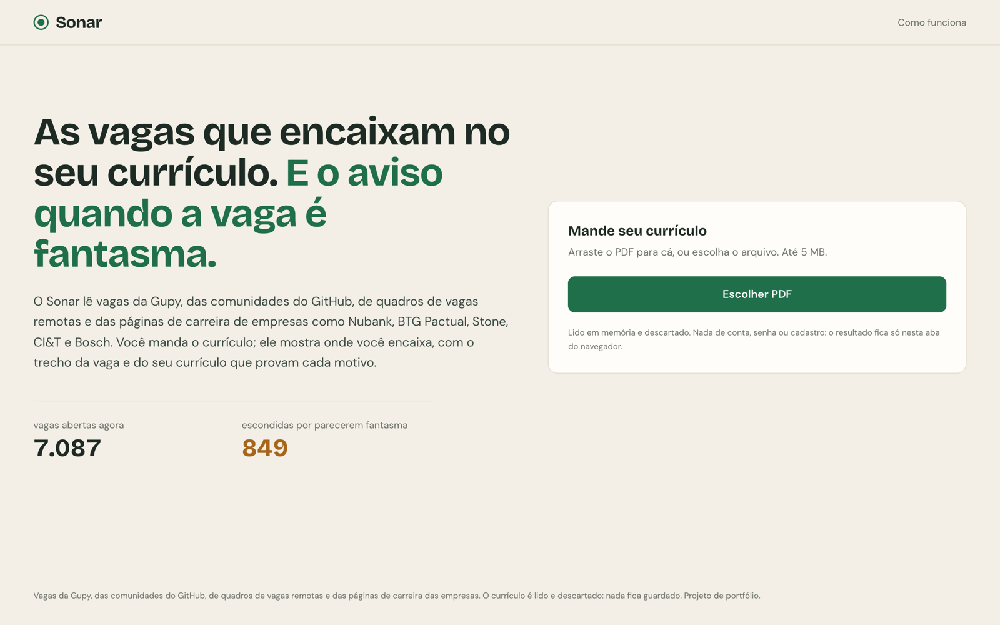
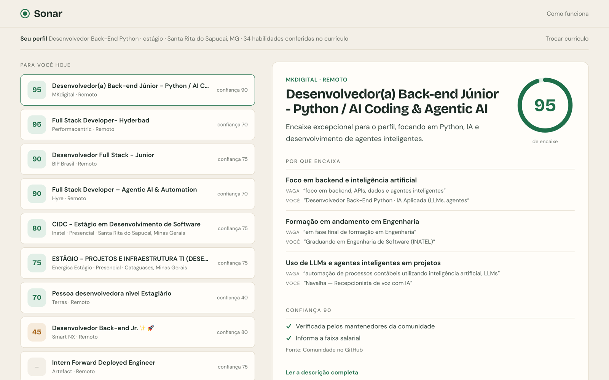
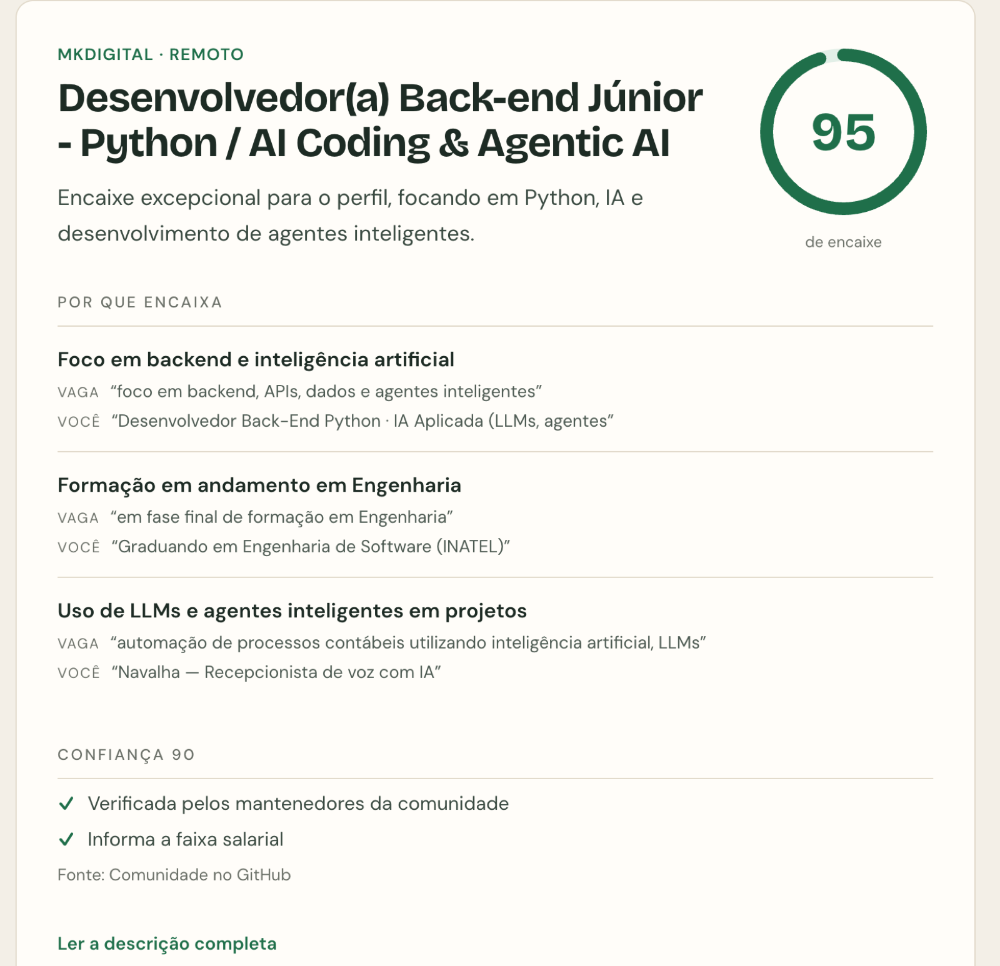
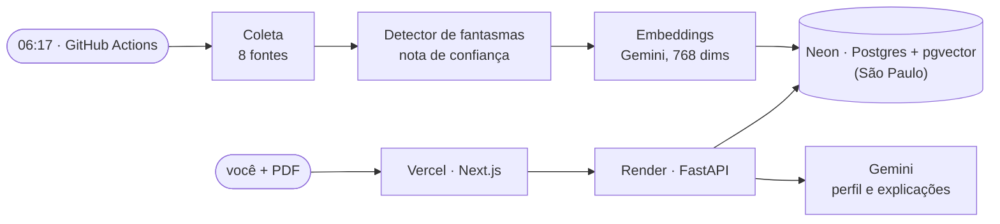

# Sonar

[](https://github.com/guialmm/sonar/actions/workflows/ci.yml)
[](https://github.com/guialmm/sonar/actions/workflows/coleta.yml)

**No ar: [sonar-vagas.vercel.app](https://sonar-vagas.vercel.app)**. Mande seu currículo em PDF e veja na hora.

**As vagas que encaixam no seu currículo. E o aviso quando a vaga é fantasma.**
O Sonar junta mais de 7 mil vagas abertas de 8 fontes. Você manda o currículo e ele mostra
onde você encaixa, com uma nota e o porquê. Cada motivo cita um trecho da vaga e um trecho do seu
currículo, e as citações são conferidas no texto original antes de aparecer na tela. Vagas que
parecem fantasma (abertas há meses, republicadas toda semana, sem empresa, banco de talentos)
perdem confiança e ficam de fora.

Sem conta e sem cadastro: o PDF é lido em memória e descartado, e o resultado fica só naquela
aba do navegador.

| A tela inicial | O resultado |
|---|---|
|  |  |



## De onde vêm as vagas

Só fontes públicas, por API ou JSON aberto, lidas todo dia de manhã:

| Fonte | O que traz |
|---|---|
| **Gupy** | O portal que a maioria das empresas brasileiras usa. Busca por quase 50 termos de tecnologia |
| **Páginas de carreira** (Greenhouse, Ashby, Lever, SmartRecruiters) | A vaga direto da empresa: Nubank, BTG Pactual, Stone, XP, Inter, C6, QuintoAndar, CI&T, Bosch, Serasa Experian, VTEX, Wellhub e outras. De empresa global, só as vagas no Brasil |
| **Comunidades no GitHub** | `backend-br/vagas`, `frontendbr/vagas` e mais 10 quadros mantidos como issues |
| **Himalayas e Remotive** | Vagas remotas que aceitam quem mora no Brasil |

O LinkedIn ficou de fora de propósito: ele não tem API pública de vagas, e raspar o site viola
os termos de uso.

## Como funciona



1. **Coleta.** Cada fonte vira o mesmo formato de vaga. Uma fonte que falha não derruba as outras,
   e a vaga guarda o histórico: quando foi vista primeiro, quantas vezes, se sumiu.
2. **Detector de vagas fantasmas.** Uma nota de confiança de 0 a 100 a partir de sinais que dá para
   explicar, todos mostrados na tela:
   - perde pontos: banco de talentos, publicada há mais de 60 dias, prazo vencido, republicada pela
     mesma empresa, descrição curta, texto idêntico a outras vagas da empresa, anunciante anônimo
     publicando vagas em série;
   - ganha pontos: publicada na página de carreira da própria empresa, verificada pelos
     mantenedores da comunidade, informa salário, publicada nesta semana.

   Abaixo de 40, a vaga não aparece. Vaga que a fonte tirou do ar (ou que ninguém vê há 14 dias)
   sai da busca.
3. **Leitura do currículo.** O PDF é lido em memória. A IA extrai o perfil (cargo, nível,
   cidade, habilidades), e cada habilidade só fica se o trecho que a comprova estiver de fato no
   currículo: o mesmo verificador de citações das explicações.
4. **Busca híbrida.** Proximidade de sentido (pgvector, HNSW) somada à busca por palavra-chave nas
   habilidades (o que também cobre vagas ainda sem vetor). Depois, regras duras: nível
   compatível, vaga presencial só no seu estado, confiança mínima. Vaga repetida aparece uma vez.
   Saem até 150, 30 por vez na tela.
5. **Explicação.** As primeiras vagas vão para a IA em lotes pequenos: nota, resumo, até 4 motivos
   e até 3 lacunas. Todo motivo precisa citar a vaga, e todo ponto forte também o currículo. O
   verificador procura cada citação no texto real (tolerando acento e espaço) e **descarta o motivo
   cuja citação não existe**: a IA não consegue inventar requisito nem experiência.

## Decisões que valem contar

- **Custo zero.** Coleta no GitHub Actions, banco no Neon, API no Render, site na Vercel e IA no
  plano gratuito do Gemini. Daí as restrições: 1.000 embeddings por dia (a busca por palavra-chave
  cobre o resto), poucas explicações por minuto (lotes de 4, cache por perfil e vaga, a mesma
  explicação em andamento nunca é paga duas vezes), e um prazo de 90 s para a IA responder antes
  de o site dizer "tente de novo em instantes".
- **Modelos em sequência.** Quando um modelo do Gemini está sobrecarregado, a chamada passa para o
  próximo e o que falhou fica 5 minutos de fora.
- **Privacidade por construção.** Não há tabela de usuários nem de currículos. O cache de
  explicações usa um hash do perfil, em memória.
- **Limite por IP** nas rotas que chamam a IA (3 currículos e 8 lotes de explicação a cada 10
  minutos), para o plano gratuito sobreviver a um visitante insistente.

## Stack

- **Backend:** Python 3.12, FastAPI, SQLAlchemy 2 (async) + Alembic, Postgres 17 com pgvector,
  `google-genai`, `pypdf`, `httpx`.
- **Frontend:** Next.js 16 (App Router, Cache Components), React 19, Tailwind CSS 4, Motion.
- **Infra:** GitHub Actions (CI e coleta diária), Neon, Render, Vercel.
- **Testes:** 81 testes no backend com respostas reais das fontes como fixtures, e lint e build do
  frontend no CI.

## Rodar localmente

```bash
docker compose up -d db                     # Postgres + pgvector na porta 5436
cd backend
python -m venv .venv && .venv/bin/pip install -r requirements.txt
echo "GEMINI_API_KEY=..." > ../.env         # chave gratuita do Google AI Studio
.venv/bin/alembic upgrade head
.venv/bin/python -m app.coleta todas        # coleta (alguns minutos)
.venv/bin/python -m app.confianca           # nota de confiança
.venv/bin/python -m app.encaixe vetores     # embeddings (até a cota do dia)
.venv/bin/fastapi dev app/main.py --port 8004
```

```bash
cd frontend && npm install && npm run dev   # http://localhost:3003
```

Testes: `cd backend && .venv/bin/python -m pytest` (com o Postgres do `docker compose` no ar).

---

Projeto de portfólio de [Guilherme Almeida](https://github.com/guialmm).
